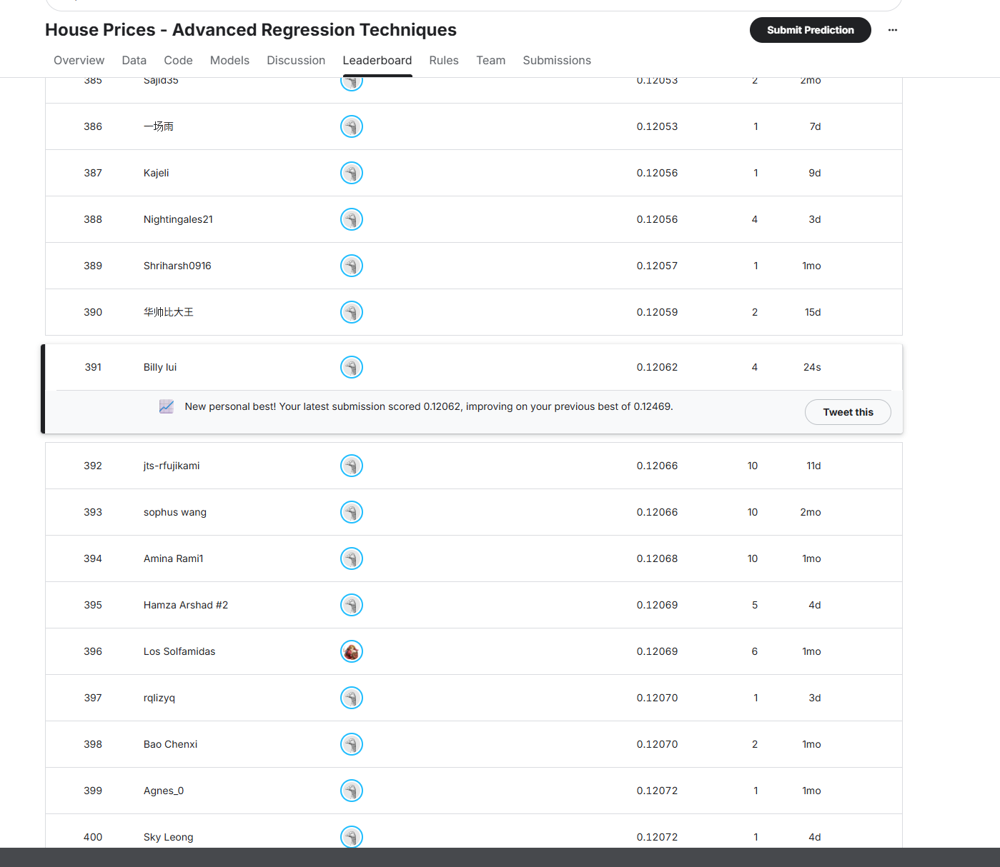

# Ames housing prices

I started this project to try ridge and lasso on a real dataset, then compared them with tree-based models. CatBoost gave the best Kaggle result.

**Score: 0.12062 · Rank: 391 ·  top 9.7%**

The ranking is from the screenshot below. The top-10% estimate uses 4,002 teams from an screenshot.



## Results

| Model | Kaggle score |
|---|---:|
| XGBoost | 0.12877 |
| Three-model blend | 0.12575 |
| Lasso + XGBoost, 50/50 | 0.12469 |
| CatBoost | **0.12062** |

The final model uses depth 6, 2,000 trees, a learning rate of 0.03 and L2 leaf regularization of 3. It predicts log price, then converts the predictions back to dollars.

For CatBoost, I used five outer folds and three inner folds to choose parameters. Its local log RMSE was 0.12189. That is separate from the Kaggle score. Some local gains were concentrated in two unusually large houses; the other 1,458 houses had slightly higher error than the earlier blend. More detail is in [model notes](docs/model_notes.md).

This repo contains the final CatBoost code. The result tables also record earlier experiments; their full training code is not included here.

## Running it

Tested on Windows with R 4.5.0 and CatBoost 1.2.10.

Download the files from [Kaggle](https://www.kaggle.com/competitions/house-prices-advanced-regression-techniques/data) and put them in `data/`. You need `train.csv`, `test.csv` and `sample_submission.csv`.

```powershell
Rscript scripts/install_packages.R
Rscript scripts/train_model.R
```

The prediction file is `artifacts/model/submission.csv`. That is the file to upload to Kaggle.

If Rscript is not on PATH, use its full path:

```powershell
& 'C:\Program Files\R\R-4.5.0\bin\Rscript.exe' scripts/train_model.R
```

For data or packages stored elsewhere:

```powershell
Rscript scripts/train_model.R --data-dir="C:/path/to/data" --library="C:/path/to/R-library" --output-dir="artifacts/run-2"
```

To load the saved model or rerun cross-validation:

```powershell
Rscript scripts/make_submission.R
Rscript scripts/cross_validation.R
```

Cross-validation takes much longer than fitting the final model. Each run needs a new output folder. The install script and package URL in `renv.lock` are for Windows; other platforms need the matching [CatBoost R package](https://catboost.ai/docs/en/installation/r-installation-binary-installation).

## Notes

- Missing numeric values use medians from the training fold. Categories go directly to CatBoost.
- Added features cover house age, total area, bathrooms, facilities and quality × area.
- Four of five outer folds chose the maximum number of trees tested. There may be room for more tuning.
- The data and folds were explored repeatedly, so CV results are not a completely independent test.
- The training code does not use public test answers or adjust individual test predictions.
- Raw data, generated submissions and model files stay out of Git.

The renamed training and prediction scripts were checked against the submitted model. See [checks](docs/checks.md).
